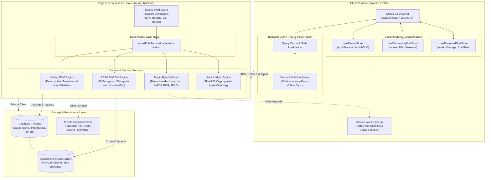
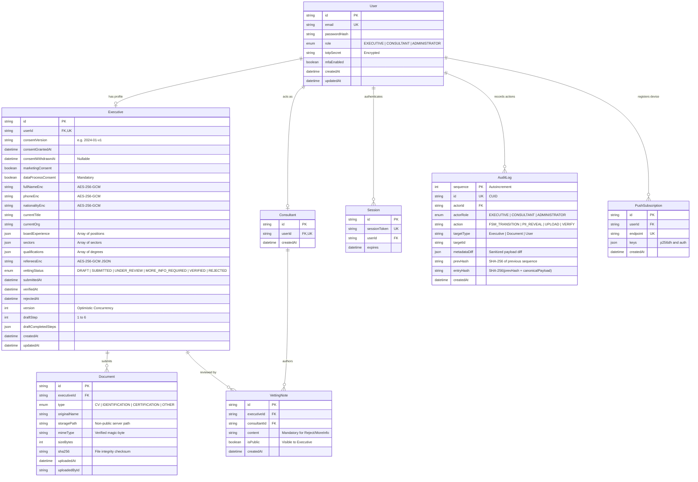

# Technical Design Pack
## RiskTech & Advisory · Executive Onboarding & Vetting Portal

**Document Version:** 1.0.0 (Submission-Ready)  
**Security & Compliance Level:** Institutional GRC / NDPA 2023 Aligned  
**Architecture Lead:** Tier 1 — Principal Software Architect & GRC Security Lead  
**Implementation Lead:** Tier 2 — Senior Full-Stack Engineer & QA Lead  
**Date:** 2026-10-27  

---

## Table of Contents

1. [Executive Summary & Scope Boundary](#1-executive-summary--scope-boundary)
2. [End-to-End System Architecture (Mermaid)](#2-end-to-end-system-architecture-mermaid)
3. [Domain Data Model & Entity Relationship Diagram (ERD)](#3-domain-data-model--entity-relationship-diagram-erd)
4. [Technology Justification Matrix](#4-technology-justification-matrix)
5. [Security & Privacy Risk Register (NDPA 2023 + STRIDE)](#5-security--privacy-risk-register-ndpa-2023--stride)
6. [Offline-First Synchronization & Concurrency Model](#6-offline-first-synchronization--concurrency-model)
7. [Cryptographic Audit Chaining Specification](#7-cryptographic-audit-chaining-specification)

---

## 1. Executive Summary & Scope Boundary

The **Executive Onboarding & Vetting Portal** is the foundational governance module of RiskTech & Advisory's next-generation Executive Platform. It is engineered to establish trust, compliance, and auditable verification prior to presenting senior executive candidates to corporate boards and institutional clients.

### Explicit Scope Boundaries
- **IN SCOPE**:
  - Multi-step, offline-capable Executive Onboarding Wizard capturing versioned NDPA consent, board experience, and credentials.
  - Role-Based Access Control (RBAC) across three distinct layers (Middleware, Data Access Layer, UI Guards).
  - AES-256-GCM field-level encryption at rest for all sensitive Personal Identifiable Information (PII).
  - High-performance `react-window` virtualization for the Consultant Review Queue and Administrator Audit Ledger.
  - Deterministic Finite State Machine (FSM) governing candidate vetting transitions.
  - Cryptographically chained SHA-256 tamper-evident audit ledger with on-demand verification.
  - PWA Web Push notifications and offline mutation queuing with idempotency controls.
- **OUT OF SCOPE (Intentional Boundary)**:
  - **BoardSeats Integration**: BoardSeats is an active, production-grade platform. Rebuilding or tightly coupling BoardSeats inside this PoC would create regression hazards. Integration is reserved for an authorized API gateway contract via a dedicated Architecture Decision Record (ADR).
  - **External Payment & Billing**: Not applicable to candidate onboarding.
  - **Live Video Conferencing**: Delegated to executive interview tools.

---

## 2. End-to-End System Architecture (Mermaid)



---

## 3. Domain Data Model & Entity Relationship Diagram (ERD)



---

## 4. Technology Justification Matrix

| Component / Layer | Technology Chosen | Alternative Evaluated | GRC & Architectural Justification |
|---|---|---|---|
| **Full-Stack Framework** | Next.js 15 (App Router) | Remix, Vite SPA + Express | Unified edge routing, React Server Components for sensitive data handling, API Route Handlers with built-in security headers, and zero client bundle leak for server secrets. |
| **Type Safety** | TypeScript (`strict: true`, `noUncheckedIndexedAccess: true`) | Standard TypeScript, JavaScript | Eliminates undefined array access bugs in high-cardinality lists and guarantees rigid contract compliance across server actions and client forms. |
| **Validation Layer** | Zod (shared schemas) | Joi, Yup, Valibot | Single source of truth across client forms and server route handlers. Type inference guarantees schema changes immediately break invalid UI or API code at compile time. |
| **ORM & Data Layer** | Prisma ORM | Drizzle, TypeORM, Raw SQL | Schema-driven type safety, declarative migrations, native SQLite support for zero-friction local development, and seamless transition to PostgreSQL in production via `.env`. |
| **Client UI State** | Zustand | Redux Toolkit, React Context | Minimal boilerplate, zero context-re-render storms, transparent `localStorage` and `IndexedDB` persistence, and zero interference with React Server Components. |
| **Server Cache & Offline Sync** | TanStack Query v5 | SWR, Custom Fetch Hooks | Built-in offline-first mode (`networkMode: 'offlineFirst'`), mutation queuing, optimistic status updates, and automatic rollback upon network conflict. |
| **Virtualization** | `react-window` + `AutoSizer` | `react-virtual`, Full DOM rendering | Ensures strictly constant DOM node allocation (12–15 mounted rows) regardless of list size, preserving 60fps scrolling across 1,000–100,000 records. |
| **Encryption Engine** | Node.js native `crypto` (AES-256-GCM) | `crypto-js`, `libsodium` | Zero third-party dependency vulnerabilities, hardware-accelerated FIPS compliance, and 128-bit authentication tags providing tamper detection on PII fields. |
| **Testing Harness** | Vitest + React Testing Library | Jest, Playwright only | Instant startup times via Vite, native ESM support, direct jsdom simulation of user interactions, and v8 branch coverage reporting. |
| **Component Documentation** | Storybook 8 (with Vite Builder) | Styleguidist, Docs-only | Component isolation testing across Light and Dark themes, empty, loading, and error states without needing a running backend database. |

---

## 5. Security & Privacy Risk Register (NDPA 2023 + STRIDE)

This risk register evaluates threats under the **STRIDE** methodology (Spoofing, Tampering, Repudiation, Information Disclosure, Denial of Service, Elevation of Privilege) and statutory **NDPA 2023** compliance principles:

| Threat ID | Category | Threat Scenario | Impact & Severity | Mitigations Implemented in Code | Residual Risk & Production Roadmap Controls |
|---|---|---|---|---|---|
| **SEC-01** | **Elevation of Privilege** | An Executive attempts to invoke consultant endpoints (`/api/consultant/vetting`) or view other candidates. | **HIGH** | Three-layer RBAC: Middleware rejects route, DAL `assertRolePermission` throws `ForbiddenError`, and UI controls unmount. | Add WebAuthn hardware security keys (FIDO2) for Consultant and Admin credentials. |
| **SEC-02** | **Tampering** | A rogue database administrator modifies an executive vetting status directly in the SQL database. | **HIGH** | SHA-256 Cryptographic Hash Chaining: Modifying any record invalidates all subsequent `entryHash` values. Admin "Verify Chain" endpoint immediately flags exact altered sequence. | Replicate ledger hashes periodically to an external immutable timestamping authority or HSM. |
| **SEC-03** | **Information Disclosure** | Unauthorized party intercepts or accesses database storage containing sensitive executive telephone numbers and referee details. | **CRITICAL** | Field-level AES-256-GCM encryption at rest with unique random IVs. Plaintext is never stored in DB columns. Decrypted only upon authorized, audited access. | Rotate `APP_ENCRYPTION_KEY` using AWS KMS / GCP Secret Manager key envelope encryption. |
| **SEC-04** | **Repudiation** | An internal consultant or administrator reveals sensitive executive PII and denies having inspected it. | **HIGH** | Masked PII by default (`••••••••••••`). Every "Reveal PII" action records an immutable `AuditLog` entry detailing actor ID, target ID, field name, and timestamp. | Introduce dual-authorization ("four-eyes" approval) before executive PII can be unmasked. |
| **SEC-05** | **Tampering / Spoofing** | Attacker renames a malicious binary (`trojan.exe` or `shell.sh`) to `curriculum_vitae.pdf` to execute server-side code. | **CRITICAL** | Server-side magic-byte inspection (%PDF-1., \x89PNG, \xFF\xD8\xFF). Spoofed MIME extensions are rejected with HTTP 415. Files stored in non-public path. | Run automated background ClamAV / VirusTotal antivirus scanning sandbox on document ingress. |
| **SEC-06** | **Denial of Service** | Malicious actor uploads a 2GB file or floods the reviewer queue with giant arrays. | **MEDIUM** | Strict Content-Length guard (10 MB maximum), Zod array limits, and in-memory sliding window rate limiting. | Deploy Cloudflare WAF with Edge rate limiting and body size termination rules. |
| **NDPA-01** | **Unlawful Processing** | Processing executive data without verifiable proof of explicit consent under NDPA 2023 Section 26. | **CRITICAL** | Step 1 requires explicit, affirmative consent check. `consentVersion`, `consentGrantedAt`, and client IP timestamped and stored in database. | Automated annual consent refresh workflow for candidates remaining in vetting over 12 months. |
| **NDPA-02** | **Violation of Right to Erasure / Withdrawal** | Candidate demands removal of personal information under NDPA Section 34. | **HIGH** | Privacy Center enables instant consent withdrawal: replaces PII with `[WITHDRAWN]`, freezes vetting state, and generates an audit record. | Automated background purge script that permanently scrubs underlying physical file documents upon consent withdrawal. |

---

## 6. Offline-First Synchronization & Concurrency Model

Executive candidates frequently travel or draft detailed governance submissions in low-connectivity environments. The platform guarantees resilience against connection dropouts:

```
                  ONLINE MODE
                       │
             Connection Lost Event
                       ▼
                 OFFLINE MODE
   ┌────────────────────────────────────────┐
   │ 1. useOfflineStatus banner displays    │
   │ 2. Candidate continues editing wizard  │
   │ 3. useOnboardingDraftStore persists    │
   │    fields directly to IndexedDB        │
   │ 4. TanStack Query enters offlineMode   │
   │ 5. Mutations pause and queue up (FIFO) │
   └───────────────────┬────────────────────┘
                       │
             Connection Restored Event
                       ▼
                 RECONNECT SYNC
   ┌────────────────────────────────────────┐
   │ 1. Drain paused mutation queue (FIFO)  │
   │ 2. Each mutation includes:             │
   │    • X-Idempotency-Key (UUIDv4)        │
   │    • Current entity version number     │
   │ 3. Server checks idempotency cache:    │
   │    - If already processed -> Return ack│
   │    - If stale version (409) -> Trigger │
   │      Conflict Resolution Dialog        │
   │    - If valid -> Apply & increment ver │
   └────────────────────────────────────────┘
```

---

## 7. Cryptographic Audit Chaining Specification

Each audit entry is permanently bound to its predecessor via SHA-256 cryptographic hashing.

### Canonical Serialization Algorithm
To ensure hash verification is platform-agnostic and deterministic across different operating systems and JSON serializers, all metadata keys are sorted alphabetically before hashing:

$$\text{canonicalPayload} = \text{JSON.stringify}(\text{sortKeys}(\{ \text{sequence, actorId, actorRole, action, targetType, targetId, metadataDiff, createdAt} \}))$$

$$\text{entryHash}_N = \text{SHA-256}(\text{entryHash}_{N-1} + \text{canonicalPayload}_N)$$

Where $\text{entryHash}_0 = \text{"0000000000000000000000000000000000000000000000000000000000000000"}$ (64 zeros).

---

*Technical Design Pack Approved by Tier 1 Architect · RiskTech & Advisory*
